# Kubernetes homelab on Proxmox VE with Talos Linux

[](https://kubernetes.io/)
[](https://www.talos.dev/)
[](https://www.proxmox.com/)
[](https://kubernetes.io/)
[](https://velero.io/)
[-black?logo=githubactions&logoColor=white)](https://github.com/actions/actions-runner-controller)
[](https://goauthentik.io/)
[](https://modelcontextprotocol.io/)
[](https://cilium.io/)
[](https://cilium.io/)
[](https://prometheus.io/)
[](https://grafana.com/)
[](https://argo-cd.readthedocs.io/)
[](https://kubernetes.github.io/ingress-nginx/)
[](https://cert-manager.io/)
[](https://github.com/rancher/local-path-provisioner)

A secure, immutable, declarative **Multi-Node Kubernetes (v1.36)** infrastructure built from bare-metal virtualization on **Proxmox VE** using **Talos Linux (v1.13.8)**, powered by **Cilium eBPF Networking**, observed via **Prometheus & Grafana**, secured with **Authentik OIDC single sign-on**, protected by **Velero and MinIO S3 backups**, serving **REST endpoints for demo vesting and salary band tools**, executing **Self-Hosted CI/CD via Actions Runner Controller (ARC)**, and managed via **GitOps (ArgoCD)**.

## What runs on this cluster
The `homelab-apps` Application in `infrastructure/gitops/homelab-apps.yaml` tells ArgoCD to deploy every manifest under `apps/`. These are the apps it runs:
- [comp-flow-platform](https://github.com/pedrogriff/comp-flow-platform), from `apps/comp-flow-platform/`: 2 API replicas, Postgres 16 on a 10Gi volume, Redis 7, an ingress, a Prometheus ServiceMonitor, SLO and burn-rate alert rules, and a Grafana dashboard.
- The compensation MCP demo, from `apps/compensation-mcp/`, on synthetic data. Its vesting tool at `/api/v1/vesting` splits a grant into 4 yearly tranches with the largest remainder method, the same method as [vesting-sim-engine](https://github.com/pedrogriff/vesting-sim-engine).
- Uptime Kuma from `apps/monitoring/` and a 3-replica podinfo test app from `apps/demo/`.
My current project is [comp-insight-advisor](https://github.com/pedrogriff/comp-insight-advisor). I plan to serve its deterministic tools from this cluster.

---

## 🏛️ Distributed System Architecture

```mermaid
flowchart TD
    GitHub["GitHub Repository (pedrogriff/homelab-k8s-talos) - Single Source of Truth"]

    Admin["Management Workstation (Debian 13)\nCLI Tools: talosctl, kubectl, cilium, helm, sops, age, velero"]

    subgraph ProxmoxHost["Proxmox VE Bare-Metal Hypervisor"]
        subgraph CPNode["Control Plane Node (IP: 10.0.0.170)"]
            API["Talos gRPC API (:50000)"]
            K8sCP["Kubernetes Control Plane (:6443)\n(etcd, kube-apiserver, scheduler)"]
            Ingress["NGINX Ingress Controller (:80 / :443)"]
            Argo["ArgoCD GitOps Engine"]
            CM["cert-manager PKI (Root CA & Issuer)"]
            VeleroOp["Velero DR Operator (velero namespace)"]
            MinIOS3["MinIO S3 Storage (10Gi PVC)"]
            ARCOp["ARC Controller & Listener (arc-systems)"]
            AuthServer["Authentik IdP Server & Redis"]
            AuthDB["Authentik PostgreSQL (5Gi DB)"]
            Prom["Prometheus Engine (5Gi TSDB)"]
            Graf["Grafana Dashboards (2Gi DB)"]
            CiliumCP["Cilium eBPF Agent & Hubble Relay"]
        end

        subgraph WorkerNode["Dedicated Worker Node (IP: 10.0.0.190)"]
            WorkerAPI["Talos gRPC API (:50000)"]
            Kubelet["Worker kubelet Engine"]
            CiliumWorker["Cilium eBPF Agent"]
            NodeAgent["Velero Kopia Node-Agent"]
            ExporterWorker["Node Exporter"]
            ARCRunner["Ephemeral CI/CD Runner Pods\n(Autoscales 0 to 5 on-demand)"]
            MCPWorker["Compensation FastMCP Engine\n(Replica on Worker)"]
            Workloads["Distributed Application Workloads\n(Podinfo Replicas, Microservices)"]
        end
    end

    Admin -->|"git push"| GitHub
    GitHub -->|"Continuous Sync Loop"| Argo
    GitHub -->|"Webhook / Job Dispatch"| ARCOp
    ARCOp -->|"Spins up on-demand"| ARCRunner
    Argo -->|"Reconciles State"| Workloads
    Argo -->|"Reconciles State"| MCPWorker

    Admin -->|"talosctl (:50000)"| API
    Admin -->|"talosctl (:50000)"| WorkerAPI
    Admin -->|"kubectl (:6443)"| K8sCP
    Admin -->|"velero backup / restore"| VeleroOp
    
    VeleroOp -->|"Streams PV Snapshots & K8s State"| MinIOS3
    NodeAgent -->|"Volume File System Snapshots"| MinIOS3
    
    Browser["AI Agent / Web Browser"] -->|"https://minio.10.0.0.170.nip.io (S3 Console)"| Ingress
    Browser -->|"https://auth.10.0.0.170.nip.io (OIDC IdP)"| Ingress
    Browser -->|"https://grafana.10.0.0.170.nip.io (Authentik SSO)"| Ingress
    Browser -->|"https://mcp.10.0.0.170.nip.io (FastMCP Engine)"| Ingress
    Browser -->|"https://hubble.10.0.0.170.nip.io"| Ingress
    Browser -->|"https://argocd.10.0.0.170.nip.io"| Ingress
    Browser -->|"https://kuma.10.0.0.170.nip.io"| Ingress
    Browser -->|"https://hello.10.0.0.170.nip.io"| Ingress
    
    Ingress -->|"Routes Traffic"| MinIOS3
    Ingress -->|"Routes Traffic"| AuthServer
    Ingress -->|"Routes Traffic"| MCPWorker
    Ingress -->|"Routes Traffic"| Graf
    Ingress -->|"Routes Traffic"| Argo
    Ingress -->|"Routes Traffic"| Workloads
    
    AuthServer -->|"Validates Sessions"| AuthDB
    Graf -->|"OIDC Token Validation"| AuthServer
    CiliumCP <-->|"eBPF Mesh Interconnect"| CiliumWorker
```



---

## 📐 Architecture Decision Records (ADRs)

### 1. Why Talos Linux instead of Traditional Linux (Ubuntu/Debian)?
* **Zero Attack Surface:** No SSH daemon, no Bash/shell, and no package manager (`apt`/`yum`) on the node.
* **API-Driven Management:** 100% managed declaratively over encrypted gRPC (`port 50000`) using `talosctl`.
* **Immutable OS:** The root filesystem is a read-only SquashFS. Operating system upgrades are atomic A/B image swaps with instant rollback capability.

### 2. Why CNCF Local Path Provisioner for Storage?
* Talos Linux enforces root immutability, meaning directories like `/opt` are read-only.
* We provisioned the **CNCF Local Path Provisioner** configured specifically for Talos's persistent partition at `/var/local-path-provisioner`.
* Enables dynamic `PersistentVolume` (PV) and `PersistentVolumeClaim` (PVC) creation for stateful databases (e.g. SQLite, PostgreSQL, Prometheus TSDB).

### 3. Why NGINX Ingress with HostNetwork?
* Eliminates awkward 5-digit NodePort numbers (`:30080`, `:30001`).
* Routes incoming HTTP/HTTPS traffic at Layer 7 based on hostname matching (`Host: kuma.homelab.local`, `Host: kuma.10.0.0.170.nip.io`).

### 4. Why Automated PKI with `cert-manager`?
* Replaces error-prone manual SSL/TLS certificate creation and renewal with Kubernetes Custom Resource Definitions (CRDs).
* Deploys a **2-Tier PKI**: A 10-year self-signed Root Certificate Authority generates an intermediate `ClusterIssuer` that signs and auto-renews 90-day application certificates on the fly.

### 5. Why GitOps with ArgoCD?
* **Git as Single Source of Truth:** Cluster desired state is version-controlled on GitHub. ArgoCD applies everything under `apps/`, so app changes go through Git instead of manual `kubectl apply`.
* **Automated Reconciliation & Self-Healing:** ArgoCD continuously detects configuration drift and automatically restores modified or deleted cluster resources back to Git state.

### 6. Why eBPF Networking with Cilium & Hubble?
* **Bypasses iptables Bottlenecks:** Uses in-kernel eBPF bytecode for hardware-speed socket routing directly inside the Talos Linux kernel.
* **Deep Network Observability (Hubble UI):** Real-time visual mapping of all network packets, HTTP methods, latency graphs, and DNS queries without sidecar injection.
* **Layer 7 Zero-Trust Security:** Enforces `CiliumNetworkPolicy` to restrict traffic between microservices at application layer granularity.

### 7. Why Full-Stack Observability with Prometheus & Grafana?
* **Real-time Telemetry & Capacity Planning:** Scrapes sub-second metrics from the Talos host kernel (CPU, RAM, Disk I/O), Kubernetes objects, and Cilium eBPF datapaths.
* **Historical Persistence:** Allocates dedicated PersistentVolumes for Prometheus Time-Series Database (TSDB) and Grafana dashboard configurations.

### 8. Why Multi-Node Horizontal Scaling (Control Plane vs. Worker Separation)?
* **Isolation of Concerns:** Control-plane resources (`etcd`, API server, Scheduler) are isolated from noisy user workloads.
* **High Availability & Anti-Affinity:** Microservice replicas are distributed across separate physical/virtual nodes, ensuring zero downtime if a worker node undergoes maintenance or failure.

### 9. Why a separate service for deterministic tools?
* **Math stays out of the model.** An LLM agent can call the vesting and salary band tools instead of doing the arithmetic itself.
* **REST today, MCP planned.** The service exposes the tools as REST endpoints at `/api/v1/vesting` and `/api/v1/salary-audit`. The code registers them with FastMCP, but no MCP endpoint is served yet.

### 10. Why Centralized Identity & Role-Based Access Control (Authentik OIDC SSO)?
* **Eliminates Identity Fragmentation:** Centralizes user accounts, MFA, and access revocation in a unified IdP.
* **Cryptographic Token Verification:** Issues signed RS256 JSON Web Tokens (JWT) containing group claims (`authentik Admins`), allowing downstream apps (Grafana, ArgoCD) to enforce granular RBAC automatically.

### 11. Why Self-Hosted Autoscaling CI/CD Runners (Actions Runner Controller - ARC)?
* **Zero-Trust Ephemeral Isolation:** Runners spawn as temporary pods for a single job and are destroyed immediately upon completion, eliminating supply chain persistence attacks.
* **Private Network Access & High Throughput:** Enables GitHub Actions to run heavy mathematical simulations and integration tests directly against in-cluster databases and private APIs.
* **Cost Efficiency:** Scales to 0 pods when idle, bursting up to 5 parallel runners on demand.

### 12. Why Cloud-Native Disaster Recovery with Velero & MinIO S3?
* **Daily and weekly backups.** Velero backs up 6 namespaces and their volumes to MinIO every day at 02:00 UTC and keeps each backup for 30 days. A weekly backup goes to Google Cloud Storage every Sunday, and Velero keeps it for 90 days.
* **Non-Corrupt Volume Snapshots:** Uses Kopia / Restic node-agents to freeze I/O and capture atomic disk backups across active PostgreSQL and Prometheus TSDB databases.
* **Instant Recovery:** Enables complete cluster reconstruction with a single `velero restore create` command.

---

## 📂 Repository Structure

```text
├── .github/
│   └── workflows/
│       └── talos-ci.yml            # Self-hosted CI workflow executing on talos-runner
├── .gitignore                      # Prevents committing credentials/private keys
├── .sops.yaml                      # Asymmetric Age encryption configuration for GitOps
├── README.md                       # Infrastructure documentation
├── cluster-config/                 # Talos Machine Configurations
│   ├── controlplane.example.yaml   # Template config for Control Plane nodes
│   └── worker.example.yaml         # Template config for scaling Worker nodes
├── infrastructure/                 # Core Cluster Infrastructure
│   ├── backup/
│   │   ├── velero-values.yaml      # Velero Disaster Recovery Helm configuration
│   │   ├── velero-credentials.secret.yaml # SOPS-encrypted S3 access keys
│   │   └── daily-schedule.yaml     # Automated daily backup schedule CRD
│   ├── certificates/
│   │   ├── cert-manager.yaml       # cert-manager deployment & CRDs (v1.17)
│   │   └── cluster-issuer.yaml     # 2-Tier PKI Root CA & ClusterIssuer
│   ├── cicd/
│   │   ├── runner-scale-set-values.yaml # ARC Runner Scale Set (runs-on: talos-runner)
│   │   └── arc-github-token.secret.yaml # SOPS-encrypted GitHub PAT
│   ├── gcp/                        # Terraform for the GCS backup bucket, Workload Identity Federation and Cloud Trace access
│   ├── identity/
│   │   └── authentik-values.yaml   # Authentik IdP (Postgres 5Gi, Redis, Ingress TLS)
│   ├── gitops/
│   │   ├── argocd.yaml             # ArgoCD Controller engine deployment
│   │   ├── argocd-ingress.yaml     # ArgoCD Web UI Ingress with TLS
│   │   └── homelab-apps.yaml       # Root GitOps Application CRD
│   ├── monitoring/
│   │   ├── prometheus-values.yaml  # kube-prometheus-stack + Grafana OIDC Generic OAuth
│   │   ├── grafana-ingress.yaml    # Grafana Dashboard HTTPS Ingress
│   │   ├── grafana-sso.secret.yaml # SOPS-encrypted Grafana OAuth client secret
│   │   └── tracing.yaml            # OpenTelemetry Collector, Jaeger and Cloud Trace export
│   ├── networking/
│   │   ├── cilium-values.yaml      # Cilium eBPF & Hubble Helm values
│   │   ├── hubble-ingress.yaml     # Hubble UI Ingress with TLS
│   │   └── security-policy.yaml    # CiliumNetworkPolicy L7 Zero-Trust rules
│   ├── storage/
│   │   ├── local-path-storage.yaml # Local Path Provisioner (StorageClass: local-path)
│   │   └── minio.yaml              # MinIO S3 Object Storage (10Gi PVC, TLS Ingress)
│   └── ingress/
│       ├── ingress-nginx.yaml      # NGINX Ingress Controller deployment
│       └── ingress-routes.yaml     # Layer 7 Ingress routing rules with TLS
└── apps/                           # Deployed Application Workloads (Managed via GitOps)
    ├── comp-flow-platform/         # comp-flow-platform API, Postgres, Redis, Ingress, SLO alerts and Grafana dashboard
    ├── compensation-mcp/           # Compensation MCP demo service on synthetic data
    │   ├── src/server.py           # FastMCP tools & FastAPI health endpoints
    │   ├── Dockerfile              # Multi-stage non-root container specification
    │   ├── requirements.txt        # Pinned microservice dependencies
    │   └── k8s/
    │       └── compensation-mcp.yaml # Deployment (Anti-Affinity), Service, Ingress
    ├── monitoring/
    │   └── uptime-kuma.yaml        # Uptime Kuma monitoring (StatefulSet/PVC)
    └── demo/
        └── hello-talos.yaml        # Stateless Podinfo test deployment
```

---

## 🛠️ Step-by-Step Multi-Node Provisioning Guide

### 1. Generating Machine Configs & Control Plane Bootstrap
```bash
# 1. Generate declarative configurations for cluster
talosctl gen config "proxmox-k8s" https://10.0.0.170:6443 --install-disk /dev/sda

# 2. Apply config to Control Plane node in maintenance mode
talosctl apply-config --insecure --nodes 10.0.0.170 --file controlplane.yaml

# 3. Bootstrap etcd and initialize Kubernetes
talosctl --talosconfig ./talosconfig bootstrap

# 4. Fetch admin kubeconfig
talosctl --talosconfig ./talosconfig kubeconfig .
```

### 2. Scaling Out Worker Nodes (Multi-Node Enrollment)
```bash
# 1. Boot new VM in Proxmox from Talos ISO and get its DHCP IP (e.g. 10.0.0.190)
# 2. Apply worker configuration
talosctl apply-config --insecure --nodes 10.0.0.190 --file worker.yaml

# 3. Verify worker node enrollment
kubectl get nodes -o wide
kubectl label node <WORKER_NODE_NAME> node-role.kubernetes.io/worker=worker
```

### 3. Deploying Core Infrastructure, Storage, Identity, CI/CD, DR & GitOps
```bash
# Deploy persistent storage & MinIO S3 Object Storage
kubectl apply -f infrastructure/storage/local-path-storage.yaml
kubectl apply -f infrastructure/storage/minio.yaml

# Deploy cert-manager & PKI ClusterIssuers
kubectl apply -f infrastructure/certificates/cert-manager.yaml
kubectl apply -f infrastructure/certificates/cluster-issuer.yaml

# Deploy NGINX Ingress Controller & TLS Routing
kubectl apply -f infrastructure/ingress/ingress-nginx.yaml
kubectl apply -f infrastructure/ingress/ingress-routes.yaml

# Deploy Cilium eBPF & Hubble UI
helm upgrade --install cilium cilium/cilium --namespace kube-system -f infrastructure/networking/cilium-values.yaml
kubectl apply -f infrastructure/networking/hubble-ingress.yaml

# Deploy Authentik Identity Provider
helm upgrade --install authentik authentik/authentik --namespace identity -f infrastructure/identity/authentik-values.yaml

# Deploy Prometheus & Grafana Observability Stack (with OIDC Single Sign-On)
helm upgrade --install prometheus prometheus-community/kube-prometheus-stack --namespace monitoring -f infrastructure/monitoring/prometheus-values.yaml
kubectl apply -f infrastructure/monitoring/grafana-ingress.yaml

# Deploy Actions Runner Controller (ARC) & Self-Hosted Runner Scale Set
helm upgrade --install arc --namespace arc-systems oci://ghcr.io/actions/actions-runner-controller-charts/gha-runner-scale-set-controller
helm upgrade --install talos-runner --namespace arc-runners -f infrastructure/cicd/runner-scale-set-values.yaml oci://ghcr.io/actions/actions-runner-controller-charts/gha-runner-scale-set

# Deploy Velero Disaster Recovery Operator
helm upgrade --install velero vmware-tanzu/velero --namespace velero -f infrastructure/backup/velero-values.yaml
kubectl apply -f infrastructure/backup/daily-schedule.yaml

# Deploy Compensation FastMCP Microservice
kubectl apply -f apps/compensation-mcp/k8s/compensation-mcp.yaml

# Deploy ArgoCD GitOps Engine
kubectl create namespace argocd
kubectl apply --server-side --force-conflicts -n argocd -f infrastructure/gitops/argocd.yaml
kubectl apply -f infrastructure/gitops/argocd-ingress.yaml
kubectl apply -f infrastructure/gitops/homelab-apps.yaml
```

---

## 🔒 Security & Secrets Management Best Practice

> **Golden Rule of DevOps:** Live cluster secrets, tokens, and private keys (`talosconfig`, `kubeconfig`, raw `controlplane.yaml`, `worker.yaml`) are strictly excluded from Git via `.gitignore`.
> 
> Secret manifests named `*.secret.yaml` are encrypted with **SOPS and age** using the rule in `.sops.yaml`, so Git stores only their ciphertext. Decrypt and apply them with `sops -d FILE | kubectl apply -f -`. ArgoCD does not decrypt them.

---

## 📊 Day-2 Operations Cheatsheet

| Task | Command |
| :--- | :--- |
| **List Velero S3 Backups** | `velero backup get` |
| **Trigger On-Demand Full Cluster Backup** | `velero backup create cluster-manual-backup --default-volumes-to-fs-backup` |
| **Inspect Backup Details & Volume Snapshots** | `velero backup describe <BACKUP_NAME> --details` |
| **Restore Namespace from S3 Backup** | `velero restore create --from-backup <BACKUP_NAME> --include-namespaces <NAME>` |
| **Inspect Self-Hosted CI/CD Runners** | `kubectl get pods -n arc-systems && kubectl get pods -n arc-runners` |
| **Inspect Authentik Identity Provider** | `kubectl get pods,pvc,ingress -n identity` |
| **Inspect MinIO S3 Object Storage** | `kubectl get pods,pvc,ingress -n storage` |
| **Inspect FastMCP Microservice** | `kubectl get pods,svc,ingress -l app=compensation-mcp` |
| **Test Vesting REST Endpoint** | `curl -k -s -X POST https://mcp.10.0.0.170.nip.io/api/v1/vesting -H "Content-Type: application/json" -d '{"total_shares": 1500, "schedule_type": "FRONT_LOADED_35_30_20_15"}'` |
| **Inspect All Cluster Nodes** | `kubectl get nodes -o wide` |
| **Inspect Workload Distribution Across Nodes** | `kubectl get pods -A -o wide --sort-by='.spec.nodeName'` |
| **Inspect Monitoring Stack** | `kubectl get pods,pvc,ingress -n monitoring` |
| **Cilium Cluster Status** | `cilium status` |
| **Hubble Real-time CLI Traffic Stream** | `cilium hubble port-forward & hubble observe` |
| **ArgoCD Applications Status** | `kubectl get applications -n argocd` |
| **Talos Live Terminal Dashboard** | `talosctl --talosconfig talosconfig dashboard -n 10.0.0.170` |
| **Talos Worker Live Dashboard** | `talosctl --talosconfig talosconfig dashboard -n 10.0.0.190` |

---

## 👤 Author & Homelab Engineer
Built by **Pedro Griff** as an Infrastructure-as-Code (IaC) and Cloud Platform portfolio project.
